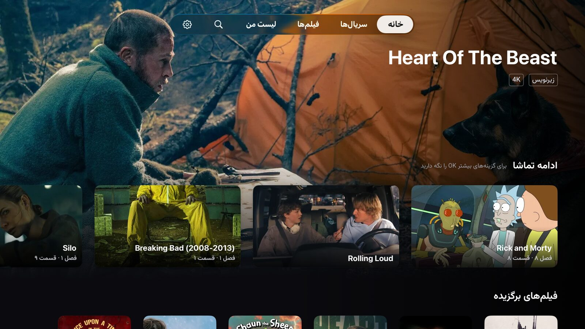
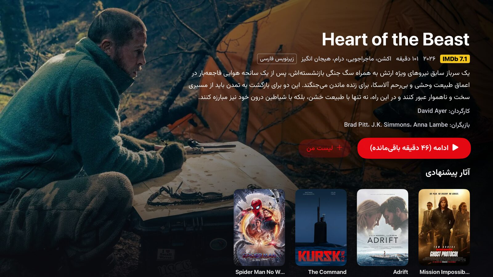
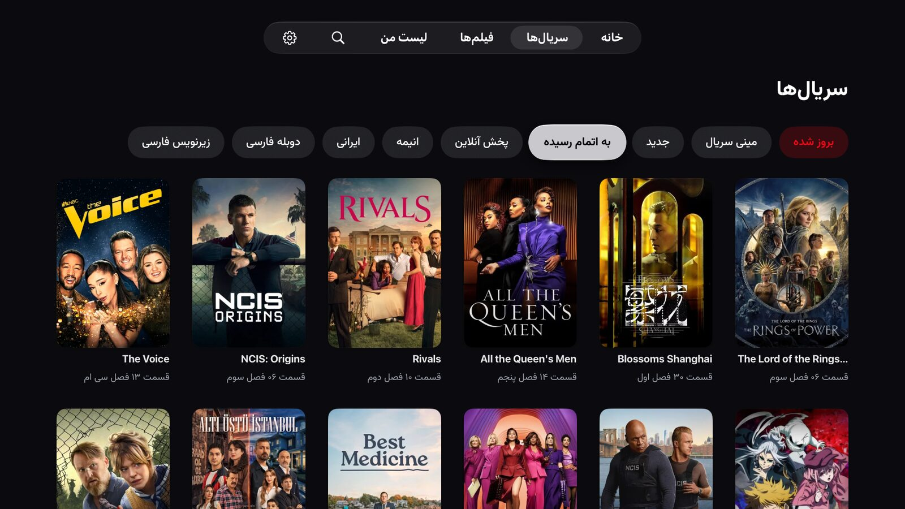
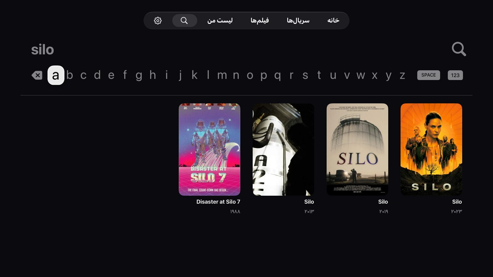
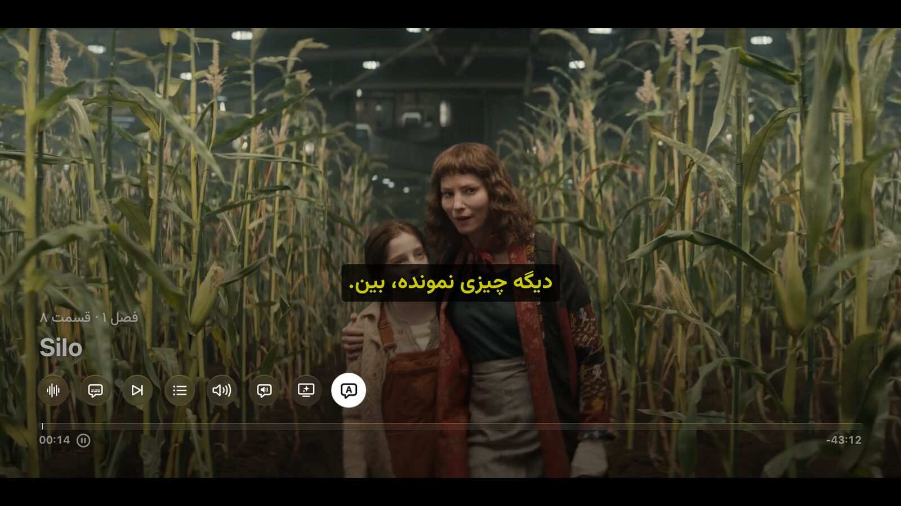
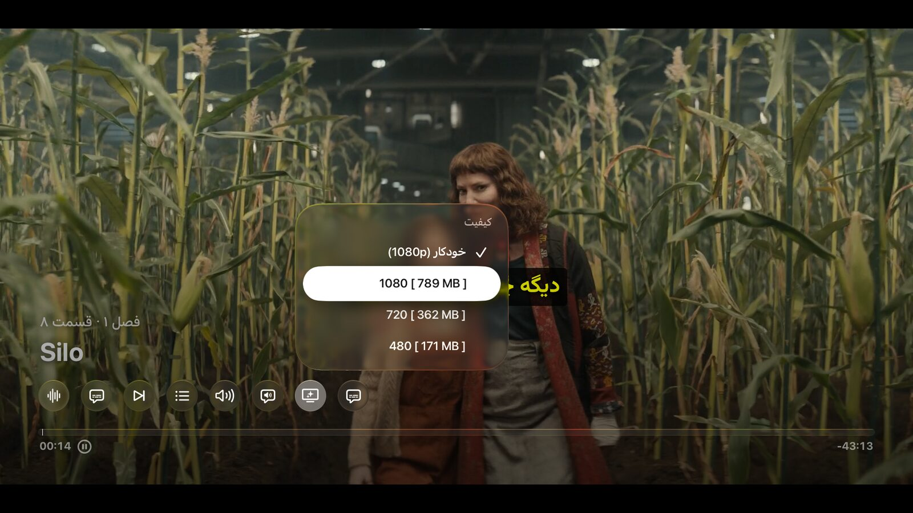

<p align="center">
  
</p>

<h1 align="center">DRooz for Apple TV</h1>

<p align="center">
  Your DLRooz movies and series on Apple TV — a native tvOS client built with SwiftUI and Apple's own video player.
</p>

<p align="center">
  <a href="https://github.com/SamMHD/DRooz-AppleTV/actions/workflows/ci.yml"></a>
  <a href="https://github.com/SamMHD/DRooz-AppleTV/actions/workflows/testflight.yml"></a>
  
  
</p>

DRooz is a tvOS port of [DRooz for Android TV](https://github.com/AliKarami/DRooz-AndroidTV): the same site client, the same «ادامه تماشا» (continue watching) logic and the same player features, in a Persian, right-to-left interface designed for the Siri Remote.

## Screenshots

| Home | Title page |
|---|---|
|  |  |
| **Series** | **Search** |
|  |  |
| **Player** | **Quality menu** |
|  |  |

## Features

- **Home** with a focus-following hero and «ادامه تماشا» first: OK plays the right episode at the right second, holding OK opens details or removes it. Then featured films, updated series, new films and series, popular, IMDb top, dubbed and kids rows.
- **Series, Films and My List** grids with infinite scroll and the site's categories as chips.
- **Title pages** with an adaptive play button («ادامه فصل ۲ قسمت ۷»…), seasons, numbered episodes with ✓ and progress, original ↔ dubbed, «لیست من» and suggestions.
- **Search** with the Apple TV keyboard, Siri dictation and recent searches.
- **Player** built on `AVPlayerViewController` (Siri Remote scrubbing, ±10 s, speed), with extra transport-bar menus:
  - **Subtitles:** Persian, English, **both at once**, or Persian for dubbed audio, with size, colour, background and ±0.5 s sync.
  - **Quality:** the site's renditions with their sizes, or automatic.
  - **Audio:** original, original 5.1 or Persian dub. The dub plays when you chose the dubbed version, and 5.1 plays when your TV or speakers support surround sound.
  - **Audio boost** (the site's loudness map), **episodes**, **next episode** with an up-next countdown, resume and automatic recovery when a stream key expires.
- Persian UI in Vazirmatn; titles keep their original names.

## Requirements

- Apple TV HD or Apple TV 4K on **tvOS 17** or newer.
- A DLRooz account.

To build: a Mac with **Xcode 26** or newer and [XcodeGen](https://github.com/yonaskolb/XcodeGen).

## Getting started

```bash
brew install xcodegen
git clone https://github.com/SamMHD/DRooz-AppleTV.git && cd DRooz-AppleTV
BUNDLE_ID=com.sammhd.drooz DEVELOPMENT_TEAM=<your team id> xcodegen generate
open DRooz.xcodeproj
```

Run the **DRooz** scheme on an Apple TV simulator or on a real Apple TV paired with Xcode (Apple TV: Settings → Remotes and Devices → Remote App and Devices).

Run the package tests (they use sanitized HTML fixtures from the Android project):

```bash
cd Packages/DroozKit && swift test
```

## Project layout

| Path | What |
|---|---|
| `Packages/DroozKit` | Swift package with no UI: HTTP and cookie handling, login, HTML parsers, watch-state rules, stores. Builds and tests on macOS too. |
| `App/Sources` | The SwiftUI tvOS app: home, grids, title page, search, settings. |
| `App/Sources/Player` | `PlayerSession` (AVPlayerViewController, transport-bar menus, resume, recovery) and the subtitle overlay. |
| `App/Resources` | Vazirmatn fonts (OFL) and the asset catalog (layered app icon, top shelf). `scripts/make_icons.py` regenerates the icons. |
| `project.yml` | XcodeGen spec and the app version (`MARKETING_VERSION`). The `.xcodeproj` and `App/Info.plist` are generated, not committed. |
| `.github/workflows` | `ci.yml` (package tests and an unsigned app build) and `testflight.yml` (release upload). |

## Releasing to TestFlight

Every push to `main` (merged pull requests included) archives a Release build on GitHub Actions and uploads it to App Store Connect for **internal TestFlight** testing. Docs-only changes are skipped. You can also push a tag like `v1.2.0` or run **Actions → TestFlight → Run workflow**.

- **Version** comes from the tag, the manual input, or `MARKETING_VERSION` in `project.yml`. Bump it there for a new release.
- **Build number** is the number of minutes since 2026-01-01 UTC, so every upload is unique and increasing.
- **Signing** uses Xcode cloud signing (an Apple Distribution certificate managed by Apple), so no certificates or profiles are stored in the repository.

One-time setup:

1. In App Store Connect, create an API key that can upload builds and use cloud-managed distribution certificates. An **Admin** team key works (Users and Access → Integrations → App Store Connect API). Download the `.p8` file; Apple only offers it once.
2. Add the repository secrets (Settings → Secrets and variables → Actions):
   - `ASC_KEY_ID`: the key ID.
   - `ASC_ISSUER_ID`: the issuer ID shown above the team keys.
   - `ASC_KEY_P8`: the full text of the `.p8` file.
3. Optional repository variables: `APPLE_TEAM_ID` (default `K3F46GZX35`) and `BUNDLE_ID` (default `com.sammhd.drooz`).

Until the key is set up, pushes skip the upload, and manual runs fail with a message saying which secrets are missing.

When processing finishes (5–30 minutes), internal testers get the build in the **TestFlight** app on Apple TV.

<details>
<summary>Uploading from a Mac instead</summary>

With a team account signed in to Xcode (Settings → Accounts):

```bash
xcodegen generate
B=$(( ($(date -u +%s) - 1767225600) / 60 ))
xcodebuild archive -project DRooz.xcodeproj -scheme DRooz -configuration Release \
  -destination 'generic/platform=tvOS' -archivePath "build/DRooz.xcarchive" \
  CURRENT_PROJECT_VERSION=$B DEVELOPMENT_TEAM=K3F46GZX35 PRODUCT_BUNDLE_IDENTIFIER=com.sammhd.drooz \
  CODE_SIGN_STYLE=Automatic CODE_SIGNING_ALLOWED=NO
xcodebuild -exportArchive -archivePath build/DRooz.xcarchive -exportPath build/upload \
  -exportOptionsPlist ExportOptions.plist -allowProvisioningUpdates
```

`ExportOptions.plist` needs `method` = `app-store-connect`, `destination` = `upload`, `teamID`, `signingStyle` = `automatic` and `testFlightInternalTestingOnly` = `true`.

</details>

## Good to know

- DRooz is an **unofficial** app made by fans and isn't affiliated with DLRooz. You need your own subscription.
- Your password and the site's session cookies are stored in the Apple TV's Keychain and are only sent to the DLRooz site.
- DLRooz allows a limited number of devices per account. The Apple TV counts as one and keeps its device cookie across logins.
- Audio boost evens out loudness by lowering loud scenes to match quiet dialogue, because the system player can't amplify. Raise the TV volume a little if it feels quiet, or turn it off in Settings or the player's menu.
- tvOS 27 adds its own **Subtitles** button for auto-generated English captions, and apps can't hide it. DRooz's subtitle menu is the button with an **A** in a speech bubble.
